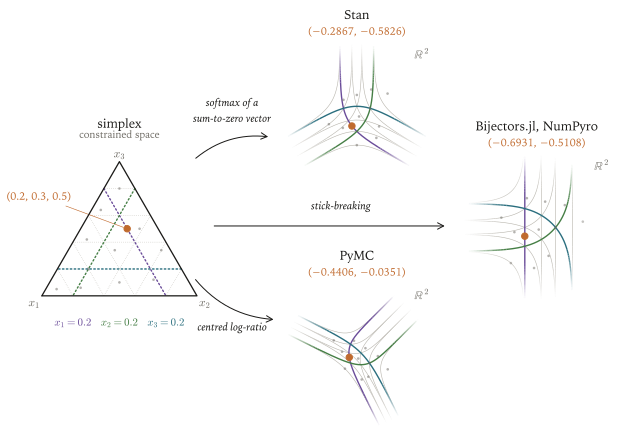
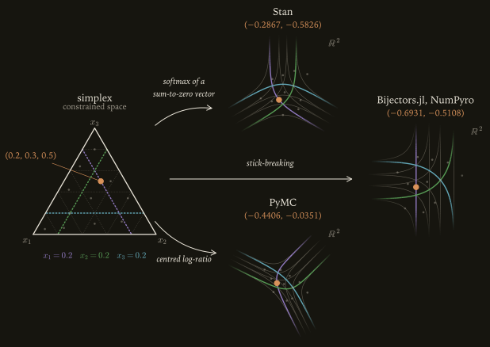
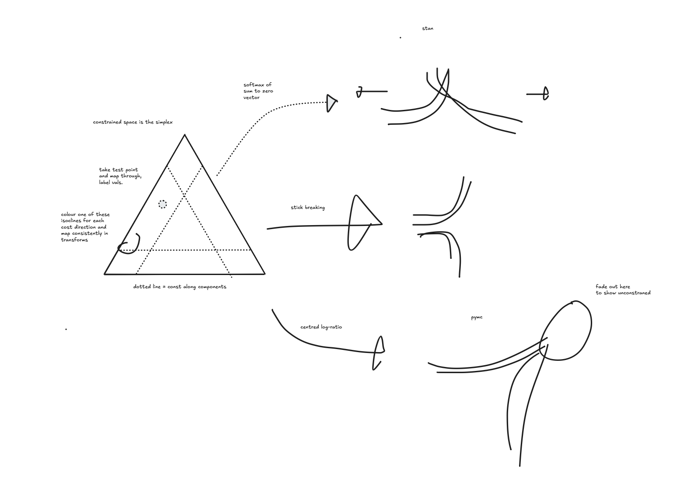
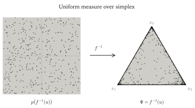
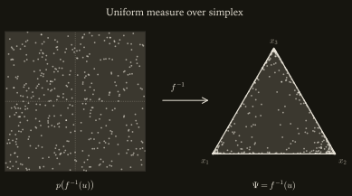
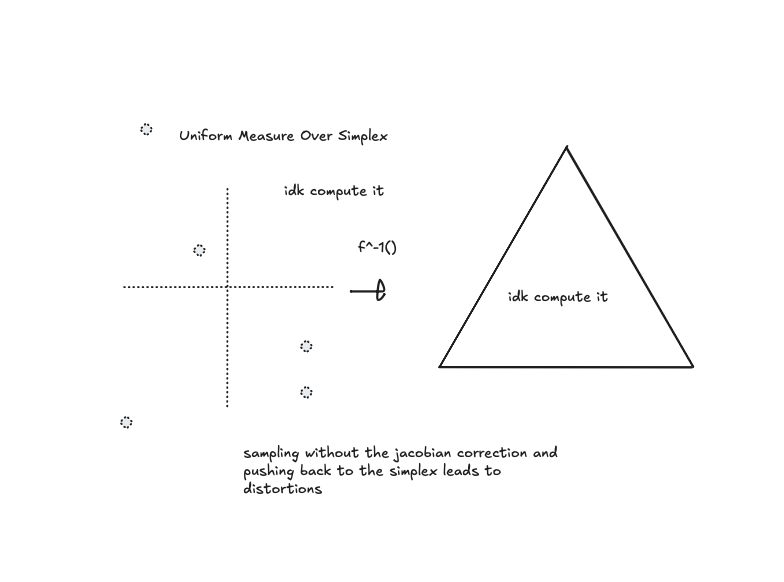

+++
title = "Aligning models in different PPLs"
hascode = true
hasmath = true
date = Date(2026, 11, 14)
rss = "RSS"
+++
@def tags = ["bayes"]

# Aligning models in different PPLs

Say you have a model in Stan, or PyMC. Maybe this "model" is multiple models in a trenchcoat --- something like a few thousand lines and a few dozen if statements. You've heard of something [cool](https://statmodeling.stat.columbia.edu/2025/10/03/its-a-jax-jax-jax-jax-world/) [in](https://examples.rxinfer.com/categories/advanced_examples/gp_regression_by_ssm/) [another](https://num.pyro.ai/en/stable/funsor.html) [PPL](https://turinglang.org/docs/usage/submodels/). Or maybe you want to see what the corresponding syntax would look like, or how fast it would run. It's probably not worth it to port your codebase over to check, but an LLM might be pretty good at this job. LLMs are best when they have a [verifiable](https://www.anthropic.com/research/building-c-compiler) [test harness](https://terrytao.wordpress.com/2026/09/12/after-math/) --- some ability to check their work against a source of truth.\sidenote{I think an underdiscussed part of the math / coding apocalypse is the ability for models to check against a source of truth *at inference time*, not just during post-training, e.g. against tests/compilers (coding) or Lean (math). This probably has implications for AI timelines in biology, AI research, materials science, computational statistics, where verification can be longer than "instant".} Statistical modelling is a little squishy, so in many cases, we can't get nearly as good a certificate of correctness. In this case, however, we can.

## The basic idea

Consider [eight-schools (non-centred edition)](https://statmodeling.stat.columbia.edu/2019/10/15/a-heart-full-of-hatred-8-schools-edition/):\sidenote{Dan Simpson might not like 8schools, but I'm using it here because: (1) I love a classic, (2) it has a constrained parameter and a transformed parameter, (3) lazy.}

$$
\begin{aligned}
\tau &\sim \text{HalfCauchy}(0, 5) \\
\mu &\sim \mathcal{N}(0, 5) \\
z_j &\sim \mathcal{N}(0, 1) \\
\theta_j &= \mu + \tau z_j \\
y_j &\sim \mathcal{N}(\theta_j, \sigma_j)
\end{aligned}
$$

We can implement this in a few PPLs:\sidenote{Stan model taken from [posteriordb](https://github.com/stan-dev/posteriordb/blob/ac100554d3fd0bbbc58ca8ea08ccabc0486c7f51/posterior_database/models/stan/eight_schools_noncentered.stan).}

~~~
<div class="code-tabs">
  <div class="code-tab-buttons">
    <button class="code-tab-btn active" data-tab="c1-turing">Turing</button>
    <button class="code-tab-btn" data-tab="c1-stan">Stan</button>
    <button class="code-tab-btn" data-tab="c1-numpyro">NumPyro</button>
  </div>
  <div id="c1-turing" class="code-tab-content active">
~~~

```julia
@model function eight_schools_noncentered(J, y, sigma)
    tau ~ truncated(Cauchy(0, 5); lower = 0)
    mu ~ Normal(0, 5)
    theta_trans ~ MvNormal(zeros(J), I)
    theta := mu .+ tau .* theta_trans
    y ~ MvNormal(theta, Diagonal(sigma .^ 2))
end
```

~~~
  </div>
  <div id="c1-stan" class="code-tab-content">
~~~

```stan
data {
  int<lower=0> J; // number of schools
  array[J] real y; // estimated treatment
  array[J] real<lower=0> sigma; // std of estimated effect
}
parameters {
  vector[J] theta_trans; // transformation of theta
  real mu; // hyper-parameter of mean
  real<lower=0> tau; // hyper-parameter of sd
}
transformed parameters {
  vector[J] theta;
  // original theta
  theta = theta_trans * tau + mu;
}
model {
  theta_trans ~ normal(0, 1);
  y ~ normal(theta, sigma);
  mu ~ normal(0, 5); // a non-informative prior
  tau ~ cauchy(0, 5);
}
```

~~~
  </div>
  <div id="c1-numpyro" class="code-tab-content">
~~~

```python
def eight_schools_noncentered(J, sigma, y=None):
    tau = numpyro.sample("tau", dist.HalfCauchy(5.0))
    mu = numpyro.sample("mu", dist.Normal(0.0, 5.0))
    with numpyro.plate("school", J):
        theta_trans = numpyro.sample("theta_trans", dist.Normal(0.0, 1.0))
        theta = numpyro.deterministic("theta", mu + tau * theta_trans)
        numpyro.sample("y", dist.Normal(theta, sigma), obs=y)
```

~~~
  </div>
</div>
~~~

Are these implementations the same? What does it mean for implementations to be "the same"? Some PPLs work differently, but all of the above allow us to evaluate the joint log density of the sampled parameters $\Psi$ and data $y$:

$$
\log p(\Psi, y) = \underbrace{\log p(\tau) + \log p(\mu) + \sum_j \log p(z_j)}_{\text{prior}} + \underbrace{\sum_j \log p(y_j \mid \theta_j, \sigma_j)}_{\text{likelihood}}
$$

Probably the most natural way to define "sameness" is to ask if the models produce the same joint log pdf --- is this quantity identical up to an additive constant? This catches most implementation errors, for example, incorrect prior parameterizations,\sidenote{This is an easy mistake to make, even for LLMs --- things like sd vs variance parameterization of the normal, shape and scale vs shape and rate for the gamma, and so on.} coding errors in parameter transforms (that don't sit post-likelihood in the DAG), and so on.

Accepting this definition of "sameness", we can compute the difference in log densities between implementations at some test points $\Psi$, and if the spread of the difference is small enough across test points, we can declare the implementations identical, at least insofar as they define the same joint log density.\sidenote{Other differences can still exist, some of which I'll discuss in more detail below. As an example, this does nothing to check pushforwards of the sampled parameters, e.g. generated quantities in Stan.}

That is, we accept that two implementations are the same if, for a set of differences, 

$$
d_i = \log p_{\text{PPL}_1}(\Psi_i, y) - \log p_{\text{PPL}_2}(\Psi_i, y),
$$

where both log densities expect constrained points,\sidenote{This is not actually the case, which we will discuss in a moment.} we come in under the following tolerance:

$$
\max_i \frac{\lvert d_i - \operatorname{median}(d) \rvert}{\max\!\big(1,\ \lvert \log p_{\text{PPL}_2}(\Psi_i, y) \rvert\big)} < 10^{-8} \text{ or so}
$$

Why this metric? Well, different PPLs compute slightly different things when they hand you "the log density". This is an implementation detail; some (Stan) will expect, by default, samples after their internal bijections $f(\Psi)$ into $\R^d$, and some (Stan) drop constants from the log density, and some don't. The second point is what we're correcting for here.

When one PPL drops constants from the log density and another doesn't, the differences at some test points will be spread --- because of numerical error --- tightly around some arbitrary real number, not zero. So we check that the largest deviation from the median difference is small, instead of the largest deviation from zero.

A quick note on the internal bijections thing:

## Different PPLs use different internal mappings into $\R^d$

For this to work, we need to be sure that, say, the log density method for Turing (`logjoint(model, params)`) and the log density method for BridgeStan (`log_density(model, q)`) are doing the same thing. Why might this not be the case? Well, we usually define the model on some constrained subspace of $\R^d$, but we'd like the sampler to move over all of $\R^d$, because otherwise the geometry can get wonky. PPLs handle this mostly under the hood for us, defining their own bijectors that map constrained random variables to unconstrained space, and map samples back.

Stan, by default, expects unconstrained points to be passed into the log density. Most other PPLs expect constrained points. So we need to either force Stan to accept constrained points, or hit our constrained points with Stan's bijector to push them to the space Stan is expecting. Different languages can use different transforms, complicating the problem:

| library | transform | (0.2, 0.3, 0.5) becomes |
| --- | --- | --- |
| Stan 2.40 | [`simplex[3]`](https://mc-stan.org/docs/2_40/reference-manual/transforms.html#simplex-transform.section) | (−0.2867, −0.5826) |
| Bijectors.jl 0.16 | [`SimplexBijector`](https://github.com/TuringLang/Bijectors.jl/blob/main/src/bijectors/simplex.jl) | (−0.6931, −0.5108) |
| NumPyro 0.22 | [`StickBreakingTransform`](https://num.pyro.ai/en/stable/distributions.html#stickbreakingtransform) | (−0.6931, −0.5108) |
| PyMC 6.4 | [`SimplexTransform`](https://www.pymc.io/projects/docs/en/stable/api/distributions/generated/pymc.distributions.transforms.SimplexTransform.html) | (−0.4406, −0.0351) |


~~~
<figure>
<div class="code-tabs fig-tabs">
  <div class="code-tab-buttons">
    <button class="code-tab-btn active" data-tab="f1-diagram">Diagram</button>
    <button class="code-tab-btn" data-tab="f1-sketch">Sketch</button>
  </div>
  <div id="f1-diagram" class="code-tab-content active">
    
    
  </div>
  <div id="f1-sketch" class="code-tab-content">
    
  </div>
</div>
<figcaption>
~~~
Different PPLs map the same constrained points into $\R^d$ differently. If the log density function expects points in the internal unconstrained space, the same test points may not be valid between different PPLs.
~~~
</figcaption>
</figure>
~~~

The other complexity here comes from the Jacobian correction. As a quick refresher, in the post, we've been talking about mapping some constrained space to $\R^d$. But the model isn't just a "space", it's an "allocation of probability over that space". Given the simplex, we have some measure --- uniform, Dirichlet, etc. --- that defines how probability mass is distributed over the constrained space. When we want to sample in the unconstrained space, we need to ensure that the distribution of probability mass in this new space is equivalent to the distribution in the old space. Otherwise we'll get distortions when mapping the points back for interpretation. To align the probability mass allocation when sampling, we multiply by the Jacobian correction.

~~~
<figure>
<div class="code-tabs fig-tabs">
  <div class="code-tab-buttons">
    <button class="code-tab-btn active" data-tab="f2-diagram">Diagram</button>
    <button class="code-tab-btn" data-tab="f2-sketch">Sketch</button>
  </div>
  <div id="f2-diagram" class="code-tab-content active">
    
    
  </div>
  <div id="f2-sketch" class="code-tab-content">
    
  </div>
</div>
<figcaption>
~~~
Samples drawn uniformly over $\R^d$ have a non-uniform distribution when pushed back to the simplex.
~~~
</figcaption>
</figure>
~~~

BridgeStan, which takes in unconstrained points, allows us the option of seeing either $\log p(\Psi, y)$ or $\log p(\Psi, y) + \log \lvert \det J_{f^{-1}}\big(f(\Psi)\big) \rvert$ when evaluating `log_density(model, q)`. By default, *this includes the Jacobian adjustment*. This will also mess with our comparison; $\log p(\Psi, y)$ and $\log p(\Psi, y) + \log \lvert \det J_{f^{-1}}\big(f(\Psi)\big) \rvert$ differ by a non-constant term, so we can't compare them. The Jacobian adjustment also depends on the specific bijection chosen, so we should turn that off for a clean comparison.

When checking alignment between PPLs, the most important component is understanding what the `log_density` function is actually doing, and then ensuring you set things up so that it expects the same (constrained) points and does not include a Jacobian correction. I don't know of any languages that force you to include the Jacobian correction or fail to supply an `unconstrain(.)` function, but if they exist, they'd be pretty annoying to work with.


## What can't this check?

It's possible to get the "same model" in some sense while returning a different log density. And it's possible to get a "different model", in a sense, with the same log density. As an example of the latter case, consider a model which has the same model blocks, but contains different --- perhaps flawed --- pushforwards of those parameters, e.g. in Stan's `generated quantities`. This can actually be pretty consequential --- imagine a model that marginalizes or pseudo-marginalizes out most of its latent parameters; messing up the GQ step here can totally ruin the model results, and ensuring matching log densities does nothing to help here.

In the other direction, many optimizations we'd like to make to models return different log densities. Marginalization or conjugacy tricks are one example here --- anything that changes the sampled dims will trip this method up --- but also many approximate methods (e.g. low-rank representations of nonparametrics) can have different log densities while being, in some sense, "basically the same model".

This is potentially problematic if log density equality is intended to be used as a target for optimizations within a PPL (e.g. taking a Stan model and making it "fast" via LLM iteration).


## Results

WIP: Add some concrete examples here, maybe as a new blog.


## LLM disclaimer

All writing is my own. I used Claude for formatting, including adding sources to (and turning raw text into) tables (e.g. for the simplex bijectors), turning sketches into diagrams, custom CSS, checking code, and proofreading math for correctness, along with related fiddly tasks and optimizations.
